<div align="center">





<a href="https://www.linkedin.com/in/veer-pratap-raghav"></a>
<a href="https://www.instagram.com/veer.pratap.raghav"></a>
<a href="https://github.com/veer714?tab=followers"></a>
<a href="https://github.com/veer714?tab=repositories"></a>

</div>

---

## ☀️ The story behind the sun

I started out building clean interfaces and record-management systems for schools and colleges. Then I got curious about what is *behind* the data, and I have been going deep into **machine learning** ever since.

I am a B.Tech (AI & Data Science) student, and these days I split my time between two things:

- **Learning the ML workflow properly**: models, pipelines, evaluation, and getting a trained model in front of real users.
- **Keeping my DSA sharp**, because good fundamentals sit underneath everything worth building.

### 🔥 What drives me

| | |
|---|---|
| 🔍 **Curiosity over shortcuts** | I moved from building interfaces to asking *why* the data behaves the way it does. I want to understand a model, not just call `.fit()`. |
| 🧱 **Fundamentals first** | Strong DSA and clean code are the base layer. Every project here is a step toward something I can fully explain. |
| 🚢 **Ship the whole pipeline** | A notebook is not the finish line. I train the model, wrap it in an API or an app, and write down what broke along the way. |
| 🌱 **Learn in public** | My repos are honest practice work, and I keep a visible "next steps" list on each one so growth is easy to see. |

> *The best way to predict the future is to build it, one commit at a time.*

---

## 🪐 Planets · my tech stack

<div align="center">

</div>

<div align="center">

**Languages & core**


**ML & data**


**Backend, tools & workflow**


<br/>


</div>

---

## 🌙 Moons · projects

Each card is a live view of the repository: stars, forks, language and the latest push. Click a card to open the repo.

<!--PROJECTS:START-->
<table>
<tr><td width="50%"><a href="https://github.com/veer714/Practice_FAST_API-"></a></td><td width="50%"><a href="https://github.com/veer714/CIFAR_10"></a></td></tr>
<tr><td width="50%"><a href="https://github.com/veer714/spam-classifier"></a></td><td width="50%"><a href="https://github.com/veer714/leetcode_solutions"></a></td></tr>
</table>
<!--PROJECTS:END-->

### Inside the projects

<details>
<summary><b>🖼️ CIFAR_10</b> · image classification with a deep CNN</summary>

<br/>

A convolutional neural network built with Keras/TensorFlow that classifies the 60,000 colour images of CIFAR-10 into 10 categories, trained on Google Colab.

- **Pipeline:** data loading, a 10% validation split, sample visualisation, mean/std standardisation, one-hot labels
- **Augmentation:** rotation, shifts, flips, brightness, zoom, shear and channel shift via `ImageDataGenerator`
- **Architecture:** 4 conv blocks (32 → 64 → 128 → 256 filters), each with two `Conv2D` layers, L2 regularisation, batch norm, max pooling and rising dropout (0.2 → 0.5)
- **Training:** Adam (lr 0.0005), batch size 64, up to 150 epochs with `ReduceLROnPlateau` and `EarlyStopping` restoring the best weights
- **Demo:** downloads any image from a URL, preprocesses it like the training data and predicts its class

</details>

<details>
<summary><b>📧 spam-classifier</b> · SMS / e-mail spam detection with NLP</summary>

<br/>

A machine-learning web app that labels a message as **Spam** or **Ham** using NLP, built with Python, Scikit-learn and Streamlit.

```text
raw text → clean → tokenize → remove stopwords → stem → TF-IDF → model → Spam / Ham
```

- Trained and compared **Multinomial NB, Bernoulli NB, Extra Trees and XGBoost**, and shipped Multinomial Naive Bayes as the best performer
- Dataset: the SMS Spam Collection
- Planned next: confidence scores, multi-language detection and LSTM/BERT models

</details>

<details>
<summary><b>🚀 Practice_FAST_API-</b> · FastAPI + Pydantic, from model to REST API</summary>

<br/>

A hands-on repo with two projects:

1. **Spam classifier as an API:** the same NLP model served through a Streamlit app and a FastAPI `POST /predict` endpoint (including the classic `numpy.int64 is not JSON serializable` fix)
2. **Patient Management API:** Pydantic validation (`Field`, `Literal`, `gt/lt`), `@computed_field` for BMI and verdict, path/query params, `HTTPException`, JSON-file storage and dynamic sorting

</details>

<details>
<summary><b>🧮 leetcode_solutions</b> · DSA practice in Java</summary>

<br/>

My running log of LeetCode solutions in Java. This is the fundamentals workout behind everything else.

</details>

---

## 🛰️ Orbit log · activity

<div align="center">



</div>

### ☄️ Latest pushes

<!--ACTIVITY:START-->
- ☄️ pushed to [`veer714`](https://github.com/veer714/veer714) · 1d ago
- ☄️ pushed to [`portfolio`](https://github.com/veer714/portfolio) · 1d ago
- ☄️ pushed to [`register`](https://github.com/veer714/register) · 5d ago
- ☄️ pushed to [`register`](https://github.com/veer714/register) · 5d ago
- ☄️ pushed to [`register`](https://github.com/veer714/register) · 5d ago
<!--ACTIVITY:END-->

---

## 🧭 Roadmap · where I am heading

- [x] Train a CNN from scratch and add augmentation (CIFAR-10)
- [x] Build an NLP classifier and compare several models (spam detection)
- [x] Serve a model through Streamlit and FastAPI
- [ ] Share one preprocessing module between the app and the API
- [ ] Return spam probability with `predict_proba`
- [ ] Add tests with `pytest` and `TestClient`
- [ ] Containerise with Docker and deploy
- [ ] Move to a real database and add authentication (JWT)
- [ ] Try deep models for text (LSTM / BERT)

---

<div align="center">

### 🤝 Let's connect

I am happy to talk about machine learning, learning paths, or anything you are building.

<a href="https://www.linkedin.com/in/veer-pratap-raghav"><b>LinkedIn</b></a> · <a href="https://www.instagram.com/veer.pratap.raghav"><b>Instagram</b></a>

<sub>The cards above redraw themselves from my live GitHub data every few hours.</sub>

</div>
